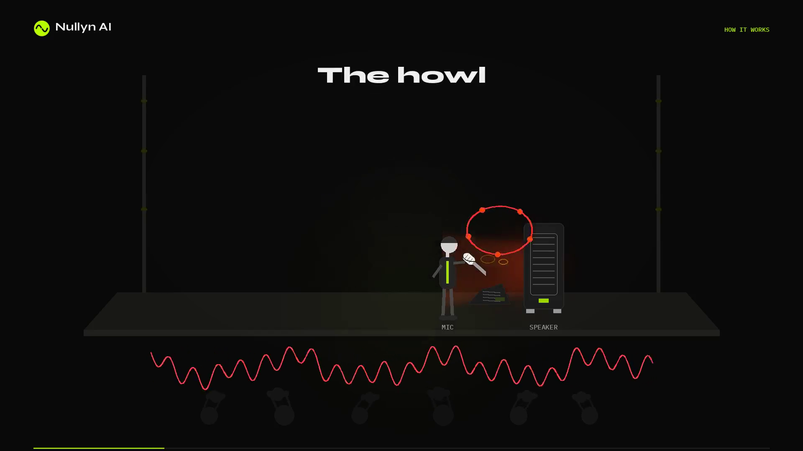

# Nullyn AI

**More gain. No feedback pain.**

AI acoustic-feedback (mic howl) suppression for live sound.

[nullyn.ai](https://nullyn.ai) · [Open-source prototype](https://github.com/krish-mm/nullyn-ai-defeedback) · [Instagram](https://www.instagram.com/nullyn.ai/)



## This repository

This is the static site for [nullyn.ai](https://nullyn.ai). There is no build step.

- **Home** (`index.html`) — the product site
- **Setup** (`setup/`) — laptop setup guide for the v1 prototype, which is ready
- **Research** (`research/`) — cited findings behind the work
- **Whitepaper** (`whitepaper/`) — whitepaper, in preparation
- **Media** (`media/`) — brand assets, research charts, and shared scripts, including the waveform background (`media/js/waveform-bg.js`)
- **Video** (`media/video/`) — how-it-works and setup-guide videos, captions, and posters
- **Front end** (`site.css`, `site.js`, `palette.css`, `fonts.css`, `fonts/`) — shared styles, typography, and palette

## Run locally

```bash
python3 -m http.server 8000
```

Open [http://127.0.0.1:8000](http://127.0.0.1:8000).

## Deploy

GitHub Pages serves the site from the `main` branch at the repository root. The custom domain `nullyn.ai` is set in `CNAME`. Merges to `main` are published by GitHub’s built-in Pages workflow; this repository has no custom Actions workflow.

## Contributing

Every change starts with a GitHub issue.

1. Open an issue that describes the work.
2. Create a branch from `main`.
3. Open a pull request against `main` and link it with `Closes #N`.
4. Merge only after review.

## Brand

- Colors: `#B6FF00` (primary), `#FF1A1A` (howl), `#0A0A0A` (background)
- Type: **Syne** for headlines, **Manrope** for body, **IBM Plex Mono** for figures and labels. Self-hosted `.woff2` files and SIL Open Font License texts are in `fonts/`.

## License

This repository does not include a software license. Site content is © Nullyn AI. The open-source prototype at [krish-mm/nullyn-ai-defeedback](https://github.com/krish-mm/nullyn-ai-defeedback) is released under the MIT License.
